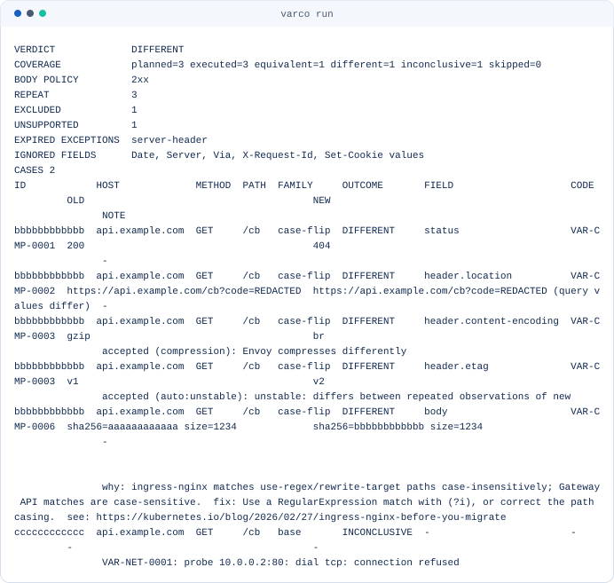
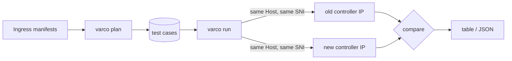

<p align="center">
  <picture>
    <source media="(prefers-color-scheme: dark)" srcset="docs/assets/varco-logo-dark.svg">
    
  </picture>
</p>

<h3 align="center">Prove that the new ingress answers like the old one, route by route,<br>
before you change the DNS. It verifies behavior; it translates nothing.</h3>

<p align="center">
  <a href="https://github.com/HarnageaGabriel/varco/actions/workflows/ci.yml">
    </a>
  <a href="go.mod">
    </a>
  <a href="LICENSE">
    </a>
  <a href="https://scorecard.dev/viewer/?uri=github.com/HarnageaGabriel/varco">
    </a>
  
</p>

<p align="center">
  <a href="#try-it-now-compare-one-route-on-two-endpoints">Try it now</a> ·
  <a href="#what-a-report-looks-like">A report</a> ·
  <a href="#design-goals">Design goals</a> ·
  <a href="#status">Status</a> ·
  <a href="#how-it-works">How it works</a> ·
  <a href="#getting-started">Getting started</a> ·
  <a href="#roadmap">Roadmap</a> ·
  <a href="#security">Security</a> ·
  <a href="#community">Community</a> ·
  <a href="#contributing">Contributing</a>
</p>

Kubernetes retired ingress-nginx in March 2026
([announcement](https://kubernetes.io/blog/2026/01/29/ingress-nginx-statement/)),
and it served about half of cloud native environments. Audit tools tell you
which annotations to translate; [ingress2gateway](https://github.com/kubernetes-sigs/ingress2gateway)
translates them. Nobody answers the next question: on **your** cluster, does the
new controller behave the same? The risk Traefik names as the worst one
([audit guide](https://traefik.io/blog/ingress-nginx-migration-audit)) is a
silent change that breaks something for a single team.

varco closes that gap. Run the two controllers side by side, each with its own
IP. varco derives test cases from your Ingress resources, sends the same
request to both IPs with the same `Host` and the same SNI, and compares the
answers.

## Try it now: compare one route on two endpoints

Download the archive for your platform from the
[release page](https://github.com/HarnageaGabriel/varco/releases/tag/v0.1.0)
and verify it per [install.md](docs/install.md), or build the binary from a
checkout, then compare a single route. No cluster access is needed:

```sh
varco diff --old 10.0.0.1 --new 10.0.0.2 --host api.example.com /
```

For whole manifests, use `plan` and `run` — plan first, look before you probe,
then execute:

```sh
varco plan -f ./manifests --format json > plan.json
varco run --plan plan.json --old 10.0.0.1 --new 10.0.0.2 --dry-run
varco run --plan plan.json --old 10.0.0.1 --new 10.0.0.2
```

Exit status 0 means the two endpoints answered identically (EQUIVALENT), 1
means at least one difference was not accepted by policy (DIFFERENT), 2 is a
usage or configuration error, 3 means a case could not be observed
(INCONCLUSIVE; 1 wins over 3), and 4 is an internal error. See
[exit-codes.md](docs/exit-codes.md) and the verdict model in
[ADR 0007](docs/adr/0007-verdict-model.md). Known differences can be accepted
with an exceptions file via `varco run --exceptions`; see
[run.md](docs/run.md).

## What a report looks like

`varco run --format table` prints the verdict, the coverage it rests on, and
every case that is not EQUIVALENT — including differences policy accepted,
marked with their exception id. Sensitive values are redacted by default.

<p align="center">
  <picture>
    <source media="(prefers-color-scheme: dark)" srcset="docs/assets/readme-run-report-dark.svg">
    
  </picture>
</p>

## Design goals

- **Verify, never translate.** varco compares two live endpoints. Manifest
  translation stays with ingress2gateway.
- **Any two endpoints.** The comparison is not tied to ingress-nginx; the same
  tool serves every future proxy change.
- **Safe by default.** Requests go only to the two IPs you name. Only `GET`,
  `HEAD` and `OPTIONS` are sent unless you opt in. Redirects are never
  followed, a rate limit is always on, and no credential is ever generated.
- **Read-only.** varco never modifies a cluster or an endpoint.
- **Deterministic.** Same input, same output. No AI in the main path. What
  varco cannot test is listed as an unsupported finding, never guessed.
- **Local and private.** No telemetry and no external service. Secrets never
  reach logs or reports.
- **Built for CI.** Stable, versioned JSON, documented exit codes, and a stable
  diagnostic code (`VAR-*`) with a documentation page for every finding.
- **One binary.** Go, Apache-2.0, free forever, no paid edition and no locked
  feature.

## Status

varco is **pre-alpha**. `v0.1.0` is published as a
[pre-release](https://github.com/HarnageaGabriel/varco/releases/tag/v0.1.0)
and is not marked latest. It is not yet on Homebrew or Krew.

| Command | State |
|---|---|
| `varco diff` | Implemented: status, `Location`, security and CORS headers, TLS version, certificate and body hash across two endpoints. |
| `varco plan` | Implemented: reads Ingress manifests or a live cluster (`--from-cluster`, `kubectl get` only) and generates deterministic test cases plus unsupported findings. Planner profiles `nginx` and `generic` per [ADR 0008](docs/adr/0008-planner-profiles.md). |
| `varco run` | Implemented: plan execution against two endpoints with a verdict per [ADR 0007](docs/adr/0007-verdict-model.md), exceptions file, per-case outcome with coverage, repeated observations (`--repeat`), body policy (`--body`), request budget (`--max-requests`), family/path filters, `--dry-run`, `--suggest-exceptions`, deterministic explanations, redaction per [ADR 0006](docs/adr/0006-redaction.md). |
| Releases | `v0.1.0` is published as a pre-alpha [pre-release](https://github.com/HarnageaGabriel/varco/releases/tag/v0.1.0) with checksums, per-archive SBOMs, a Sigstore bundle and a build attestation; download and verification in [install.md](docs/install.md). Not on Homebrew or Krew yet. |

The output formats and flags can still change between releases.

## How it works



**Plan.** For every host and path varco generates the cases that expose a
behavior difference. They come from documented ingress-nginx behavior, mainly
the Kubernetes post [Five Surprising Ingress-NGINX Behaviors](https://kubernetes.io/blog/2026/02/27/ingress-nginx-before-you-migrate):

| Family | What it probes |
|---|---|
| `base`, `subpath`, `prefix-boundary` | `pathType` matching: the declared path, a sub-path, and `/api` against `/apivarco` |
| `trailing-slash` | The 301 for a missing trailing slash |
| `case-flip` | Case-insensitive matching on hosts where `use-regex` or `rewrite-target` is active, which is host-wide across all Ingresses |
| `dot-segments`, `double-slash` | URL normalization before matching |
| `http-redirect` | Plain HTTP redirected to HTTPS |
| `cors-preflight` | The `OPTIONS` preflight when `enable-cors` is set |
| `rewrite`, `app-root`, `redirect-annotation` | `rewrite-target`, `app-root`, `permanent-redirect` and `temporal-redirect` |
| `default-backend`, `unmatched-route` | The controller's default backend and a request no rule catches (synthetic plan-wide cases) |
| `head`, `host-variant` | HEAD handling (RFC 9110 section 9.3.2) and host matching (RFC 3986 section 3.2.2, RFC 9110 section 7.2): one `HEAD` request and three `Host` header variants (upper-cased, trailing dot, explicit default port with SNI kept plain) per concrete host on the smallest planned path of that host (the lexicographically smallest planned request path, so the plan does not depend on the order of the input) (synthetic plan-wide cases) |

Annotations that cannot be tested from outside, such as timeouts or backend
protocol, are reported as findings. See [plan.md](docs/plan.md).

**Probe.** varco dials the IP you give it directly, with no DNS and no proxy,
and writes the request target byte for byte, so `/a%2Fb`, `/a/../b` and `//x`
reach the wire unchanged. It sets `Host` and SNI independently, captures the
TLS version and certificate without trusting them, and hashes the body.

**Compare.** It compares the status code, the `Location` header, security and
CORS headers, the TLS version, the certificate and the body hash. Volatile
headers such as `Date` and `Server` are left out. An exceptions file marks
accepted differences in `varco run`; see [run.md](docs/run.md).

## Getting started

`v0.1.0` is published as a pre-alpha
[pre-release](https://github.com/HarnageaGabriel/varco/releases/tag/v0.1.0);
download and verify it per [install.md](docs/install.md). Building from a
source checkout instead requires Go 1.26 or newer:

```sh
git clone https://github.com/HarnageaGabriel/varco.git
cd varco
make build        # writes bin/varco
make test lint
```

Later tags follow the same [release process](docs/release-process.md); Homebrew
and Krew are not available yet.

Usage details and examples are in [usage.md](docs/usage.md).

## Roadmap

- [x] **M0** Repository scaffold, CI, diagnostic-code registry, ADRs
- [x] **M1** `varco diff` for one or more routes on two endpoints
- [x] **M2** `varco plan` from Ingress manifests
- [x] **M2.5 Safety and correctness** Redaction by default, cookie attribute comparison, verdict model, and input limits
- [x] **M3 `varco run`** Comparator and policy evaluator, exceptions file, default-backend and unmatched-route case families, repeated baseline observations for flaky fields, body compared on 2xx by default, request budget and path exclusion, `--dry-run` and `--suggest-exceptions`, and a JSON summary
- [x] **M4 Production readiness, part 1** Release engineering (the release workflow produces draft releases from `v0.1.0`), planner profiles `nginx` and `generic` ([ADR 0008](docs/adr/0008-planner-profiles.md)), and read-only cluster read via kubectl get
- [x] **M5 Adoption, part 1** Explanations for known ingress-nginx quirks on `DIFFERENT` cases
- [ ] **Open for contributors** `kind` end-to-end tests with pinned ingress-nginx and Envoy Gateway (needs Docker), TLS version range and ALPN probes, opt-in TLS security policy, a JUnit/markdown run summary, offline HTML report, CI summaries, Homebrew and krew — see the issues labelled [`good first issue`](https://github.com/HarnageaGabriel/varco/issues?q=is%3Aopen+label%3A%22good+first+issue%22) and [`help wanted`](https://github.com/HarnageaGabriel/varco/issues?q=is%3Aopen+label%3A%22help+wanted%22)

Out of scope: manifest translation, shadowing production traffic, load testing
and authenticated flows. varco only checks the answer to an anonymous request,
for example a 401 or a redirect to a login page.

## Security

- **Read-only.** varco never writes to a cluster or an endpoint; `--from-cluster` invokes only `kubectl get`.
- **Safe methods only.** Plans send only `GET`, `HEAD` and `OPTIONS`; `varco diff` does the same unless you pass `--allow-unsafe-methods`. Redirects are never followed and no credential is ever generated.
- **Redaction by default.** Location query values, cookie values and other sensitive strings come out as `REDACTED` ([ADR 0006](docs/adr/0006-redaction.md)); `--show-sensitive` opts out with a warning.
- **No telemetry.** varco contacts only the endpoints you name; no external service, no metrics.
- **Reporting.** Vulnerabilities go through the process in [SECURITY.md](SECURITY.md).

`v0.1.0` is published as a pre-alpha pre-release: GoReleaser archives with
per-archive SBOMs, `checksums.txt` covered by a Sigstore bundle and a GitHub
build attestation. Verify downloads per [install.md](docs/install.md).
Homebrew and Krew are not available yet.

## Community

Good places to start:

- Issues labelled [`good first issue`](https://github.com/HarnageaGabriel/varco/issues?q=is%3Aopen+label%3A%22good+first+issue%22)
- Issues labelled [`help wanted`](https://github.com/HarnageaGabriel/varco/issues?q=is%3Aopen+label%3A%22help+wanted%22)

## Contributing

Contributions are welcome. Read [CONTRIBUTING.md](CONTRIBUTING.md) and
[CONVENTIONS.md](CONVENTIONS.md) first. Commits need a DCO sign-off
(`git commit -s`). Architecture decisions live in [docs/adr](docs/adr).
Maintainer workflow notes are in [docs/maintainers.md](docs/maintainers.md).

## FAQ

**Does varco send traffic to my production services?**
Only to the two IPs you pass, with safe methods, a rate limit and no
credentials. Point it at a staging pair, or at the parallel controller
you set up for the cutover.

**Why not just replay production traffic?**
Shadowing is more invasive and out of scope for now. varco proves route-level
equivalence from the Ingress definitions.

**What do the exit codes mean?**
`0` EQUIVALENT, `1` DIFFERENT (a difference policy did not accept), `2` invalid
usage or configuration, `3` INCONCLUSIVE, `4` internal error. A proven
difference outranks missing data: `1` wins over `3`. See
[exit-codes.md](docs/exit-codes.md) and the verdict model in
[ADR 0007](docs/adr/0007-verdict-model.md).

**What does a green verdict not prove?**
`EQUIVALENT` covers only the planned cases, the declared hosts and paths, and
anonymous requests - what it does not cover is listed in
[limitations.md](docs/limitations.md).

**Does it read the controller ConfigMap?**
Yes, optionally: with `--from-cluster` varco reads the ingress-nginx
controller ConfigMap with `kubectl get` and warns about settings that change
behavior on the wire (redirects, HSTS, TLS policy, auth, CORS). It only reads;
without `--from-cluster` it needs no cluster access at all. ConfigMap defaults
are still not guessed: what happens on the wire is what varco compares, and
`varco plan` lists what it cannot observe.

**Is it only for ingress-nginx?**
No. The old and new endpoints can be any two proxies. ingress-nginx is only
where the test cases come from.

## Documentation

- [Usage](docs/usage.md)
- [Cookbook: cutover rehearsal](docs/cookbook.md)
- [Command reference](docs/reference/README.md)
- [Plan: case families and findings](docs/plan.md)
- [Run: flags, exceptions and the report](docs/run.md)
- [Limitations: what a verdict does not prove](docs/limitations.md)
- [Threat model](docs/threat-model.md)
- [JSON Schemas](docs/schema/README.md)
- [CI: varco in a migration pipeline](docs/ci.md)
- [Troubleshooting](docs/troubleshooting.md)
- [Exit codes](docs/exit-codes.md)
- [Diagnostic codes](docs/diagnostics/README.md)
- [Architecture](docs/architecture.md)
- [Contributor guides](docs/dev/README.md)
- [Architecture decisions](docs/adr)
- [Maintainers](docs/maintainers.md)
- [Release process](docs/release-process.md)
- [Changelog](CHANGELOG.md)

## License

[Apache-2.0](LICENSE). Free to use, with no paid edition. Third-party license
notices are collected in [THIRD_PARTY_LICENSES](THIRD_PARTY_LICENSES); the
name varco is subject to the trademark policy in [TRADEMARKS.md](TRADEMARKS.md).
