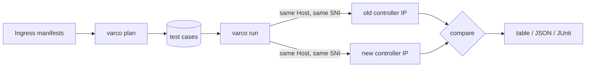

<p align="center">
  <picture>
    <source media="(prefers-color-scheme: dark)" srcset="docs/assets/varco-logo-dark.svg">
    
  </picture>
</p>

<h3 align="center">Prove that the new ingress answers like the old one, route by route,<br>
before you change the DNS. It verifies behavior; it translates nothing.</h3>

<p align="center">
  <a href="https://github.com/HarnageaGabriel/varco/actions/workflows/ci.yml">
    </a>
  <a href="go.mod">
    </a>
  <a href="LICENSE">
    </a>
  <a href="https://scorecard.dev/viewer/?uri=github.com/HarnageaGabriel/varco">
    </a>
  
</p>

<p align="center">
  <a href="#try-it-now-compare-one-route-on-two-endpoints">Try it now</a> ·
  <a href="#design-goals">Design goals</a> ·
  <a href="#status">Status</a> ·
  <a href="#how-it-works">How it works</a> ·
  <a href="#getting-started">Getting started</a> ·
  <a href="#roadmap">Roadmap</a> ·
  <a href="#contributing">Contributing</a>
</p>

Kubernetes retired ingress-nginx in March 2026
([announcement](https://kubernetes.io/blog/2026/01/29/ingress-nginx-statement/)),
and it served about half of cloud native environments. Audit tools tell you
which annotations to translate; [ingress2gateway](https://github.com/kubernetes-sigs/ingress2gateway)
translates them. Nobody answers the next question: on **your** cluster, does the
new controller behave the same? The risk Traefik names as the worst one
([audit guide](https://traefik.io/blog/ingress-nginx-migration-audit)) is a
silent change that breaks something for a single team.

varco closes that gap. Run the two controllers side by side, each with its own
IP. varco derives test cases from your Ingress resources, sends the same
request to both IPs with the same `Host` and the same SNI, and compares the
answers.

## Try it now: compare one route on two endpoints

Build the binary (see [Getting started](#getting-started)), then compare a
single route. No cluster access is needed:

```sh
varco diff --old 10.0.0.1 --new 10.0.0.2 --host api.example.com /
```

Print the test cases varco would run for your manifests, and the things it
cannot test:

```sh
varco plan -f ./manifests --format table
```

Exit status 0 means the two endpoints answered identically (EQUIVALENT), 1 means
at least one difference was not accepted by policy (DIFFERENT), and 3 means a
case could not be observed (INCONCLUSIVE); 1 wins over 3. See
[exit-codes.md](docs/exit-codes.md). To execute a whole plan and accept known
differences, use `varco run` with an exceptions file:

```sh
varco run --plan plan.json --old 10.0.0.1 --new 10.0.0.2 --exceptions exceptions.yaml
```

## Design goals

- **Verify, never translate.** varco compares two live endpoints. Manifest
  translation stays with ingress2gateway.
- **Any two endpoints.** The comparison is not tied to ingress-nginx; the same
  tool serves every future proxy change.
- **Safe by default.** Requests go only to the two IPs you name. Only `GET`,
  `HEAD` and `OPTIONS` are sent unless you opt in. Redirects are never
  followed, a rate limit is always on, and no credential is ever generated.
- **Read-only.** varco never modifies a cluster or an endpoint.
- **Deterministic.** Same input, same output. No AI in the main path. What
  varco cannot test is listed as an unsupported finding, never guessed.
- **Local and private.** No telemetry and no external service. Secrets never
  reach logs or reports.
- **Built for CI.** Stable, versioned JSON, documented exit codes, and a stable
  diagnostic code (`VAR-*`) with a documentation page for every finding.
- **One binary.** Go, Apache-2.0, free forever, no paid edition and no locked
  feature.

## Status

varco is **pre-alpha**. Nothing is released yet.

| Command | State |
|---|---|
| `varco diff` | Implemented: status, `Location`, security and CORS headers, TLS version, certificate and body hash across two endpoints. |
| `varco plan` | Implemented: reads Ingress manifests and generates deterministic test cases plus unsupported findings. |
| `varco run` | Implemented: plan execution, exceptions file, per-case verdict with coverage, repeated observations (`--repeat`) that accept unstable fields and `--suggest-exceptions`, body policy (`--body`), request budget (`--max-requests`), family/path filters, and `--dry-run` (M3, part 2). |
| M3 the rest | Next: a JUnit summary. |
| Cluster read, `kind` golden tests, releases | Planned. |

The output formats and flags can still change before the first release.

## How it works



**Plan.** For every host and path varco generates the cases that expose a
behavior difference. They come from documented ingress-nginx behavior, mainly
the Kubernetes post [Five Surprising Ingress-NGINX Behaviors](https://kubernetes.io/blog/2026/02/27/ingress-nginx-before-you-migrate):

| Family | What it probes |
|---|---|
| `base`, `subpath`, `prefix-boundary` | `pathType` matching: the declared path, a sub-path, and `/api` against `/apivarco` |
| `trailing-slash` | The 301 for a missing trailing slash |
| `case-flip` | Case-insensitive matching on hosts where `use-regex` or `rewrite-target` is active, which is host-wide across all Ingresses |
| `dot-segments`, `double-slash` | URL normalization before matching |
| `http-redirect` | Plain HTTP redirected to HTTPS |
| `cors-preflight` | The `OPTIONS` preflight when `enable-cors` is set |
| `rewrite`, `app-root`, `redirect-annotation` | `rewrite-target`, `app-root`, `permanent-redirect` and `temporal-redirect` |

Annotations that cannot be tested from outside, such as timeouts or backend
protocol, are reported as findings. See [plan.md](docs/plan.md).

**Probe.** varco dials the IP you give it directly, with no DNS and no proxy,
and writes the request target byte for byte, so `/a%2Fb`, `/a/../b` and `//x`
reach the wire unchanged. It sets `Host` and SNI independently, captures the
TLS version and certificate without trusting them, and hashes the body.

**Compare.** It compares the status code, the `Location` header, security and
CORS headers, the TLS version, the certificate and the body hash. Volatile
headers such as `Date` and `Server` are left out. An exceptions file for
accepted differences is planned for `varco run`.

## Getting started

Requires Go 1.26 or newer. There is no release yet, so build from source:

```sh
go install github.com/HarnageaGabriel/varco/cmd/varco@latest
varco version
```

Or from a checkout:

```sh
make build        # writes bin/varco
make test lint
```

Usage details and examples are in [usage.md](docs/usage.md).

## Roadmap

- [x] **M0** Repository scaffold, CI, diagnostic-code registry, ADRs
- [x] **M1** `varco diff` for one or more routes on two endpoints
- [x] **M2** `varco plan` from Ingress manifests
- [ ] **M2.5 Safety and correctness** Redaction by default, cookie attribute comparison, verdict model, and input limits (in progress)
- [ ] **M3 `varco run`** Comparator and policy evaluator, exceptions file, repeated baseline observations for flaky fields, default-backend case family, body compared on 2xx by default, request budget and path exclusion, and JSON/JUnit/markdown summary
- [ ] **M4 Production readiness** `kind` end-to-end tests with pinned ingress-nginx and Envoy Gateway, TLS version range and ALPN probes, opt-in TLS security policy, read-only cluster and ingress-nginx ConfigMap read, generic versus ingress-nginx planner rules, macOS and arm64 CI, signed releases with provenance, Homebrew, and krew
- [ ] **M5 Adoption** Explanations for known ingress-nginx quirks, offline HTML report, and CI summaries

Out of scope: manifest translation, shadowing production traffic, load testing
and authenticated flows. varco only checks the answer to an anonymous request,
for example a 401 or a redirect to a login page.

## Contributing

Contributions are welcome. Read [CONTRIBUTING.md](CONTRIBUTING.md) and
[CONVENTIONS.md](CONVENTIONS.md) first. Commits need a DCO sign-off
(`git commit -s`). Architecture decisions live in [docs/adr](docs/adr). Report
vulnerabilities as described in [SECURITY.md](SECURITY.md).

## FAQ

**Does varco send traffic to my production services?**
Only to the two IPs you pass, with safe methods, a rate limit and no
credentials. Point it at a staging pair, or at the parallel controller
you set up for the cutover.

**Why not just replay production traffic?**
Shadowing is more invasive and out of scope for now. varco proves route-level
equivalence from the Ingress definitions.

**Does it read the controller ConfigMap?**
No. ConfigMap defaults such as timeouts, TLS policy and body size do not
appear on Ingress resources, but their effects show up on the wire, which is
what varco compares. `varco plan` lists what it cannot observe.

**Is it only for ingress-nginx?**
No. The old and new endpoints can be any two proxies. ingress-nginx is only
where the test cases come from.

## Documentation

- [Usage](docs/usage.md)
- [Plan: case families and findings](docs/plan.md)
- [Exit codes](docs/exit-codes.md)
- [Diagnostic codes](docs/diagnostics/README.md)
- [Architecture decisions](docs/adr)
- [Changelog](CHANGELOG.md)

## License

[Apache-2.0](LICENSE). Free to use, with no paid edition.
