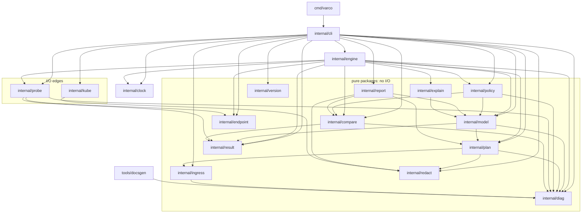

# Architecture

This is the map a new contributor needs to navigate varco's code: where each
package sits, which package is allowed to touch the outside world, and which
function makes each decision the tool reports.

Every claim here was read out of the source in this repository. The layering
rules come from [CONVENTIONS.md](../CONVENTIONS.md); the decisions they encode
live in the ADRs under [docs/adr](adr).

## 1. The layering rules, and where they are in the code

`CONVENTIONS.md` states the layering rules. Here is each one next to the code
that implements it.

| Rule | Code | How to check it |
|---|---|---|
| `cmd/` wires | [`cmd/varco/main.go`](../cmd/varco/main.go) | The whole file is 12 lines: `main()` calls `cli.Run(os.Args[1:], os.Stdin, os.Stdout, os.Stderr)` and exits with its return code. It imports only `os` and `internal/cli`. |
| `internal/cli` adapts | [`internal/cli`](../internal/cli) | `cli.Run` dispatches `help`/`version`/`diff`/`plan`/`run` to `runDiff`, `runVersion`, `runPlan`, `runRun`. It owns the `flag` sets, the input validation, the file reads and the exit codes. It holds no comparison logic. |
| `internal/engine` orchestrates | [`internal/engine`](../internal/engine) | `engine.Diff` and `engine.Run` take a `clock.Clock` and a `ProbeFunc` and drive the pure packages: `compare.Results`, `policy.Evaluate`, `explain.Explain`, `model.Verdict`. It never formats output and never reads a flag. |
| Pure packages perform no I/O | `plan`, `compare`, `diag`, `report` (and `model`, `policy`, `explain`, `ingress`, `redact`, `endpoint`, `result`, `version`) | Each of those packages takes its inputs as arguments and returns values. `report` writes to an injected `io.Writer`; `ingress` parses an injected `io.Reader`; neither opens a file, a socket or a process. |
| The prober and the cluster reader are the only I/O edges | [`internal/probe`](../internal/probe), [`internal/kube`](../internal/kube) | `probe.Do` dials the endpoint (`net.Dialer.DialContext`), writes the request and reads the response. `kube.DefaultRunner.Run` executes `kubectl get` and nothing else. Below the CLI, these are the only two packages that touch the network, a cluster or a process. The CLI itself reads files and writes stdout/stderr: that is its job as the adapter. |

Two rules hold across all packages and are worth knowing before you touch
anything:

- **Interfaces are defined by the consumer.** The engine never imports a
  "prober interface" from somewhere else: `engine.ProbeFunc` and `clock.Clock`
  are declared in `internal/engine` and `internal/clock`, and the CLI passes
  `probe.Do` and `clock.Real{}` into them. The same goes for
  `kube.Runner`, declared in `internal/kube` and implemented by
  `kube.DefaultRunner`.
- **One wall clock.** `internal/clock/clock.go:23` is the only `time.Now()`
  call in non-test code; every other consumer receives time through
  `clock.Clock` or through an injected `time.Time`.

## 2. Package map

"I/O" in the second column means the package itself opens a socket, a process
or a file. "Imported by" lists the packages in this repository that import it
(verified with `go list -f '{{.ImportPath}} {{join .Imports " "}}' ./...`).

| Package | I/O | Purpose | Main exported API | Imported by |
|---|---|---|---|---|
| `cmd/varco` | process | The binary. Wires `cli.Run` and turns its return value into the process exit code. | `main` | – |
| `internal/cli` | files, stdout, stderr | Adapts arguments to operations: flag sets, input validation, file reads, exit codes. | `Run(args, stdin, stdout, stderr) int` | `cmd/varco` |
| `internal/engine` | none (orchestrates) | Runs a comparison or a plan execution: ordering, rate limiting, concurrency, budget, coverage. | `Diff`, `Run`, `DryRun`, `FilterCases`, `DiffConfig`, `RunConfig`, `Endpoints`, `ProbeFunc`, `ValidateRate`, `ValidateConcurrency`, `ValidateRepeat` | `internal/cli` |
| `internal/plan` | none | Derives deterministic probe cases and findings from Ingress resources. | `Build`, `Options`, `Plan`, `Case`, `Finding`, `Warning`, `Source`, `Header`, `ConfigMapWarnings`, the `Family*` / `Scheme*` / `Method*` / `Profile*` constants | `internal/cli`, `internal/engine`, `internal/model`, `internal/report` |
| `internal/ingress` | none | Parses Kubernetes Ingress manifests into a small model. | `Parse(r io.Reader)`, `Ingress`, `Rule`, `Path`, `TLS`, `APIVersion`, `MaxInputBytes` | `internal/cli`, `internal/plan` |
| `internal/model` | none | The value types shared by execution, policy and reporting; the per-case outcome and the aggregate verdict. | `ProbeCase`, `Evaluation`, `Difference`, `Explanation`, `Coverage`, `RunReport`, `Outcome` + `OutcomeEquivalent`/`OutcomeDifferent`/`OutcomeInconclusive`, `Verdict`, `Summarize`, `FromPlanCase(s)` | `internal/cli`, `internal/engine`, `internal/explain`, `internal/policy`, `internal/report` |
| `internal/compare` | none | Compares two captured responses field by field. Reports every difference; decides nothing. | `Results`, `Difference`, `BodyPolicy` + `BodyPolicy2xx`/`BodyPolicyHash`/`BodyPolicyNone`, `ParseBodyPolicy` | `internal/cli`, `internal/engine`, `internal/policy`, `internal/report` |
| `internal/policy` | none | The separate policy layer: decides which observed differences an exception or an unstable field accepts. | `Evaluate`, `File`, `Exception`, `Match`, `Expiry`, `Load`, `ExpiredIDs`, `IgnoredFields`, `RenderSuggestions`, `SchemaVersion`, `UnstableExceptionID` | `internal/cli`, `internal/engine` |
| `internal/explain` | none | Maps a known ingress-nginx behavior to a stable, source-linked explanation for a `DIFFERENT` case. | `Explain(evaluation, family)` | `internal/engine` |
| `internal/report` | none (writes to an injected writer) | Renders the table and the versioned JSON output. The only place that redacts and serializes. | `Table`, `JSON`, `RunTable`, `RunJSON`, `PlanTable`, `PlanJSON`, `Options`, `JSONDocument`, `PlanDocument` | `internal/cli` |
| `internal/probe` | **network** | Sends one constrained HTTP/1.1 request to a numeric endpoint and captures the answer. | `Do(ctx, Request)`, `Request`, `ValidHost`, `ValidPath`, `ValidSNI`, `ValidHeaderName`, `ValidHeaderValue`, `CredentialHeader`, `ForbiddenHeader` | `internal/cli`, `internal/engine` |
| `internal/kube` | **cluster** | Reads Kubernetes resources through the user's `kubectl`, read-only. | `Runner`, `DefaultRunner`, `FetchIngresses`, `FetchConfigMap`, `CommandError`, `NotFound` | `internal/cli` |
| `internal/diag` | none | The stable diagnostic registry (`VAR-*` codes) and the collector. | `Code` + the `Code*` constants, `Entry`, `Diagnostic`, `Error`, `New`, `Lookup`, `List`, `Collector`, `Severity` | `internal/cli`, `internal/compare`, `internal/engine`, `internal/ingress`, `internal/model`, `internal/plan`, `internal/policy`, `internal/probe`, `tools/docsgen` |
| `internal/redact` | none | Removes sensitive values from data before serialization. | `URL`, `Text` | `internal/cli`, `internal/kube`, `internal/plan`, `internal/report` |
| `internal/result` | none | The captured response shape shared by the prober and the comparator. | `Result`, `Header`, `Certificate` | `internal/cli`, `internal/compare`, `internal/engine`, `internal/model`, `internal/probe` |
| `internal/endpoint` | none | Parses numeric endpoints. Never resolves a name. | `Parse`, `Endpoint` | `internal/cli`, `internal/engine`, `internal/probe` |
| `internal/clock` | wall clock | The clock boundary: the single place the wall clock is read. | `Clock`, `Ticker`, `Real` | `internal/cli`, `internal/engine` |
| `internal/version` | none | Build metadata injected by the release linker. | `Current`, `Info` | `internal/cli` |
| `internal/e2e` | test only | The in-process end-to-end suite. Test files only; no production code. | – | – (its tests import `internal/cli`) |
| `internal/schematest` | test only | Proves the published JSON Schemas describe the outputs. Test files only. | – | – (no internal import) |
| `tools/docsgen` | files | Renders one Markdown page per diagnostic code from the registry. | `main` | – |

## 3. Package dependencies

The edges below are exactly the internal imports reported by `go list`:

Read the diagram as a flow from the top left. The CLI is the hub: it imports
fifteen of the eighteen internal packages, and the three it does not are
`internal/explain` (used only by the engine), `internal/e2e` and
`internal/schematest` (test-only). The packages with no internal import at
all are the leaves `internal/diag`, `internal/result`, `internal/endpoint`,
`internal/redact`, `internal/clock` and `internal/version`.

The arrows never point back up. `internal/model` imports `internal/plan`
(the probe case is derived from a plan case) and `internal/policy` imports
`internal/model`, but `internal/plan` and `internal/model` never import the
policy or the engine, so there is no cycle.

## 4. Data flow

### `varco diff`

1. `cmd/varco/main.go: main()` calls `cli.Run(os.Args[1:], os.Stdin, os.Stdout, os.Stderr)`.
2. `internal/cli/cli.go: Run()` dispatches to `runDiff(args[1:], stdout, stderr)`.
3. `runDiff` builds a `flag.NewFlagSet("diff", flag.ContinueOnError)`, then validates before it touches the network: `engine.ValidateRate`, `probe.ValidHost`, `probe.ValidPath`, `probe.ValidSNI`, `parseHeaders` (which rejects credential headers with `probe.CredentialHeader` and headers the prober owns with `probe.ForbiddenHeader`), and `endpoint.Parse` for `--old` and `--new`. A rejected value goes through `configFailure`, which prints a `VAR-CFG-0001` diagnostic and returns exit code 2.
4. `runDiff` assembles an `engine.DiffConfig` and calls `engine.Diff(context.Background(), config, clock.Real{}, probe.Do)`.
5. `internal/engine/diff.go: Diff()` validates the rate, sorts and de-duplicates the paths, and builds the rate limiter from the injected clock (`clk.NewTicker`). For each path it probes the old endpoint, then the new one, through the `engine.ProbeFunc` it was given.
6. `internal/probe/probe.go: Do()` validates the request (method, scheme, path, host, SNI, headers), dials the numeric endpoint with `net.Dialer.DialContext`, handshakes TLS with `InsecureSkipVerify` when the scheme is `https`, writes the request with `buildRequest` (the request target goes on the wire byte for byte), reads the response with `readResponse`, and captures it with `capture`: canonical, sorted headers, the body SHA-256 and size, the TLS version and the leaf certificate.
7. Back in `engine.Diff`, the two captures are compared with `compare.Results(path, old, new, config.IgnoreHeaders, compare.BodyPolicyHash)`.
8. `internal/compare/compare.go: Results()` compares the status, the `Location` header, the `Set-Cookie` attributes, the fixed list of security and CORS headers, the TLS version, the certificate fields and the body hash, then sorts the differences by path, field and code. A probe error is recorded as an `engine.Failure` instead of a difference.
9. `runDiff` renders the result with `report.Table` or `report.JSON`, which route every value through `displayValue` and, for `header.location`, through `redact.URL`.
10. `runDiff` turns the outcome into an exit code: any difference is 1, otherwise any failure is 3, otherwise 0.

### `varco plan`

1. `internal/cli/cli.go: Run()` dispatches to `runPlan(args[1:], stdin, stdout, stderr)`.
2. `internal/cli/plan.go: runPlan()` validates the flags (`validProfile`, the `--from-cluster` / `-f` mutual exclusion, the format) and then reads the input.
3. The input is either the manifests (`expandInputs` → `parseInputs` → `parseInput` → `ingress.Parse`) or the cluster (`loadClusterPlan` → `loadClusterPlanWithRunner` → `kube.FetchIngresses` → `kubectl get ingress -o json` → `ingress.Parse`, plus `kube.FetchConfigMap` for the controller ConfigMap).
4. `internal/ingress/ingress.go: Parse()` decodes every YAML document, ignores the kinds varco does not plan, rejects an unsupported Ingress `apiVersion` with a `VAR-PLAN-0003` diagnostic and returns the resources in document order.
5. `plan.Build(resources, plan.Options{...})` runs the planner: `newBuilder` selects the profile (`nginx` by default, `generic` when asked), `builder.run` resolves the rule hosts, `addResource` walks the rules, `addPath` turns one path into the request shapes of its families, `emit` resolves the scheme and SNI, `appendCase` validates each case, and `addSyntheticCases` adds the plan-wide families.
6. `Plan.finalize` assigns each case its ID (`hex(sha256(canonical case))[:12]`), de-duplicates and sorts the cases, the findings and the warnings.
7. `plan.ConfigMapWarnings(controllerConfig)` adds the `VAR-PLAN-0010` warnings for the ingress-nginx ConfigMap settings that are visible on the wire, and the CLI sorts them.
8. The plan is rendered by `writePlanJSON` (the JSON envelope with `schema_version` 1) or by `report.PlanTable`.

### `varco run`

1. `internal/cli/cli.go: Run()` dispatches to `runRun(args[1:], stdin, stdout, stderr)`.
2. `internal/cli/run.go: runRun()` validates the flags and resolves the endpoints with `endpointPair`, which calls `endpoint.Parse` for the http and https endpoint of each side.
3. The plan comes from the cluster (`loadRunPlanFromCluster`), from a plan JSON file (`loadRunPlan` → `readRunInput` → JSON decode, with every case, finding and warning validated by `planCaseProblem`, `planFindingProblem` and `planWarningProblem`), or from manifests (`loadRunPlan` → `parseInputs` → `plan.Build`).
4. `model.FromPlanCases(manifest.Cases)` converts the plan cases into probe cases, and `engine.FilterCases` drops the cases excluded by `--family` and `--exclude-path` and reports how many it removed.
5. The CLI refuses a plan that carries a method other than GET, HEAD or OPTIONS (`runMethods`), with a `VAR-RUN-0001` diagnostic and exit code 2.
6. `--exceptions` is read by `loadExceptions` and parsed by `policy.Load`, which validates the version, the ids, the reasons, the dates and the globs, and reports every problem as `VAR-CFG-0002`.
7. `runRun` assembles the `engine.RunConfig`, including `Now: clock.Real{}.Now().UTC()` — the injected "now" used to expire exceptions.
8. With `--dry-run`, `engine.DryRun` lists the requests the run would send and no request is sent.
9. `engine.Run(context.Background(), config, clock.Real{}, probe.Do)` executes the run: it validates the rate, the concurrency and the repeat count, normalizes the body policy, sorts the cases with `sortedCases` (the same key the planner uses), starts a rate limiter from the injected clock, and schedules up to `Concurrency` cases. A case that would exceed `--max-requests` is never probed and becomes a budget evaluation.
10. `engine.runCase` probes the old endpoint and the new endpoint, `Repeat` times each, through the injected `ProbeFunc` → `probe.Do`. A probe error becomes a `VAR-NET-0001` diagnostic on an `INCONCLUSIVE` case; a cancelled context becomes a skipped case.
11. `engine.unstableFields` compares the repeated observations of one endpoint against each other and lists the fields that disagree. A status that is unstable makes the case `INCONCLUSIVE`.
12. The first observation of each side is compared with `compare.Results(path, old, new, nil, config.BodyPolicy)`.
13. `policy.Evaluate(item, differences, config.Exceptions, config.Now, unstable)` marks the accepted differences and decides the per-case outcome.
14. For a `DIFFERENT` case, `explain.Explain(evaluation, evaluation.Family)` attaches the explanations.
15. `engine.Run` assembles the report: `model.Summarize` for the coverage, `policy.IgnoredFields` for the fields the comparator leaves out, `collectUnstable` for the unstable pairs, and `model.Verdict(report)` for the aggregate verdict.
16. `writeRunReport` renders the report with `report.RunTable` or `report.RunJSON`, which redact the display values and the error text.
17. `--suggest-exceptions` writes a new exceptions file with `policy.RenderSuggestions`; it never overwrites an existing one.
18. `runRun` maps the verdict to the exit code: `DIFFERENT` is 1, `INCONCLUSIVE` is 3, anything else is 0.

## 5. Where each decision is made

| Decision | File and function | Notes |
|---|---|---|
| Per-case outcome (`EQUIVALENT` / `DIFFERENT` / `INCONCLUSIVE`) | [`internal/policy/policy.go`](../internal/policy/policy.go) — `Evaluate` | A case is `DIFFERENT` when at least one difference was not accepted. The comparator never decides; it only reports. |
| Aggregate verdict | [`internal/model/model.go`](../internal/model/model.go) — `Verdict`, called from [`internal/engine/run.go`](../internal/engine/run.go) — `Run` | A proven difference wins over missing data, which wins over a clean run. |
| Exit code | [`internal/cli/run.go`](../internal/cli/run.go) — `runRun`; [`internal/cli/cli.go`](../internal/cli/cli.go) — `runDiff`, `configFailure`, `diagFailure` | The CLI owns the exit code, not the engine. Documented in [exit-codes.md](exit-codes.md); the decision is recorded in [ADR 0007](adr/0007-verdict-model.md). |
| Which fields are compared | [`internal/compare/compare.go`](../internal/compare/compare.go) — `Results`, `comparedHeaders`, `compareBody` | The body is compared only when both statuses are equal and 2xx, unless the policy says otherwise. |
| Which differences are accepted | [`internal/policy/policy.go`](../internal/policy/policy.go) — `Evaluate`, `File.accepting`, `Exception.matches`, `fieldMatch` | An unstable field is accepted automatically with the exception id `auto:unstable`; an exceptions file accepts the rest. |
| Redaction | [`internal/redact/url.go`](../internal/redact/url.go) — `URL`, `Text`; applied in [`internal/report/report.go`](../internal/report/report.go) — `displayValue` and [`internal/report/run.go`](../internal/report/run.go) — `displayReport`, `runError` | Redaction happens at serialization, never before the comparison, so two different secrets still produce a difference. Recorded in [ADR 0006](adr/0006-redaction.md). |
| Explanation text and source | [`internal/explain/explain.go`](../internal/explain/explain.go) — the `rules` slice and `Explain`; called from [`internal/engine/run.go`](../internal/engine/run.go) — `runCase` | One rule per known ingress-nginx behavior. A rule whose source is not the Kubernetes migration blog carries a `VERIFY:` marker. |
| The diagnostic registry | [`internal/diag/diag.go`](../internal/diag/diag.go) — the `Code*` constants and `List` | The registry is the source of truth; [ADR 0002](adr/0002-diagnostic-codes.md). |
| The case families | [`internal/plan/generate.go`](../internal/plan/generate.go) — the `Family*` constants; [`internal/plan/nginx.go`](../internal/plan/nginx.go) — the ingress-nginx profile | The families are recorded in [ADR 0005](adr/0005-plan-case-families.md), the profiles in [ADR 0008](adr/0008-planner-profiles.md). |
| The planner profile | [`internal/plan/generate.go`](../internal/plan/generate.go) — `newBuilder`, the `profileBehavior` interface, `nginxProfile` and `genericProfile` | The generic core owns the HTTP case families; the nginx profile owns the controller-specific behavior. |
| The exceptions file format | [`internal/policy/policy.go`](../internal/policy/policy.go) — `File`, `Exception`, `Match`, `Expiry`, `Load`, `SchemaVersion` | Documented in [run.md](run.md). |
| The JSON envelopes | [`internal/report/report.go`](../internal/report/report.go) — `JSONDocument`; [`internal/report/plan.go`](../internal/report/plan.go) — `PlanDocument`; [`internal/cli/plan.go`](../internal/cli/plan.go) — `writePlanJSON` | The published schemas live in [docs/schema](schema) and are proved by `internal/schematest`. |

## 6. How determinism is enforced

Same input, same output. Four mechanisms hold that up.

**Sorting before anything is observable.** Every list that reaches stdout,
stderr or the JSON envelope is in a stable order:

- `internal/compare/compare.go: Results` sorts the differences by path, then
  field, then code.
- `internal/plan/plan.go: finalize` sorts the cases by `(host, path, scheme,
  method, family, id)`, the findings and the warnings; `caseID` is
  `hex(sha256(canonical case))[:12]`, so an id never depends on the order the
  case was generated in.
- `internal/engine/run.go: sortedCases` re-sorts the cases with the same key
  the planner uses, so a run report never depends on which case finished
  first; `collectUnstable` sorts the unstable pairs by host then field.
- `internal/probe/probe.go: canonicalHeaders` sorts the captured headers by
  name, and sorts the certificate DNS names.
- `internal/diag/diag.go: List` sorts the registry by code;
  `internal/policy/policy.go: ExpiredIDs` sorts the expired ids;
  `internal/report/plan.go` and `internal/report/run.go` render in the order
  they are given, which is already sorted.

**No map iteration reaches the output.** The few places that walk a map collect
the keys first and sort them before using them:
`internal/compare/compare.go: renderCookieSet`,
`internal/probe/probe.go: canonicalHeaders`,
`internal/engine/run.go: unionFields`,
`internal/ingress/ingress.go: rawDocument.ingress` (the annotation names) and
`internal/plan/nginx.go: addAnnotationFindings`. `tools/docsgen` sorts the
file names it writes. Where a map is compared rather than printed, the
comparison is order-independent (`maps.Equal` in
`internal/compare/compare.go: equalCookieSets`).

**An injected clock.** `internal/clock` is the only package that reads the
wall clock (`clock.Real.Now`), and it is the only `time.Now()` in non-test
code. `engine.Diff` and `engine.Run` build their rate limiter from the
`clock.Clock` they are given, so a test can drive the ticker without waiting.
Time that is part of a decision is injected as a value: `engine.RunConfig.Now`
is passed down to `policy.Evaluate` and `policy.File.ExpiredIDs` to decide
whether an exception has expired.

**A stable identity for everything else.** A case id is a hash of the
canonical case, an unstable suggestion id is a hash of the host and the field
(`policy.suggestionID`), and the comparison itself is field by field on the
captured values, never on a formatting of them.

## 7. Where to look

| I want to… | Change | And also |
|---|---|---|
| Add a flag | The `flag.NewFlagSet` block of the command: `runDiff` in [`internal/cli/cli.go`](../internal/cli/cli.go), `runPlan` in [`internal/cli/plan.go`](../internal/cli/plan.go), `runRun` in [`internal/cli/run.go`](../internal/cli/run.go). Validate it in the same function and fail through `configFailure` so the exit code stays 2. | The flag list in [usage.md](usage.md) and, for `run`, [run.md](run.md). |
| Add a case family | The `Family*` constant in [`internal/plan/generate.go`](../internal/plan/generate.go), then emit the case from `builder.addPath` or `builder.addSyntheticCases`. A family that only makes sense for ingress-nginx belongs behind the `profileBehavior` interface in [`internal/plan/nginx.go`](../internal/plan/nginx.go). | The family table in [plan.md](plan.md), [ADR 0005](adr/0005-plan-case-families.md), the generic profile's family list in [ADR 0008](adr/0008-planner-profiles.md), a golden under `testdata/plan/`, and an explanation rule in [`internal/explain/explain.go`](../internal/explain/explain.go) if the family can be explained. |
| Add a diagnostic code | The `Code*` constant and the registry entry in [`internal/diag/diag.go`](../internal/diag/diag.go). | `make docs` regenerates `docs/diagnostics/<CODE>.md` and the index; `make docs-check` fails on drift. The registry is the source of truth ([ADR 0002](adr/0002-diagnostic-codes.md)). |
| Add an explanation rule | Append to the ordered `rules` slice in [`internal/explain/explain.go`](../internal/explain/explain.go). | Keep the source URL. A rule whose source is not the Kubernetes migration blog must carry a `VERIFY:` marker in its summary and a comment above the rule. |
| Add a report field | The struct in [`internal/model/model.go`](../internal/model/model.go) (`RunReport`, `Evaluation`, `Coverage`), and where it is filled in [`internal/engine/run.go`](../internal/engine/run.go) (`Run`). | The renderer in [`internal/report/run.go`](../internal/report/run.go) (`RunTable`, `displayReport`), the schema in [`docs/schema/run-report.schema.json`](../docs/schema/run-report.schema.json) (an optional field keeps `schema_version` at 1), the goldens under `testdata/run/` and `testdata/e2e/`, and the compatibility promise in [docs/schema/README.md](schema/README.md). |
| Add a compared field | `internal/compare/compare.go: Results` and the `comparedHeaders` list. | The code registry in `internal/diag` if the difference needs a `VAR-CMP-*` code, and the redaction rules in [`internal/report/report.go`](../internal/report/report.go) if the field can carry a secret. |
| Change the probe behavior | [`internal/probe/probe.go`](../internal/probe/probe.go) — this is the only place that sends a request. | [ADR 0003](adr/0003-probe-safety.md). Per `CONVENTIONS.md`, a change to request sending, TLS handling or redaction needs a maintainer to read it. |

## 8. The ADRs

The decisions behind the code live in [docs/adr](adr). Read the one that
covers the area you are about to change before you change it.

| ADR | Covers |
|---|---|
| [0001 Record architecture decisions](adr/0001-record-architecture-decisions.md) | Why the ADRs exist and their format. |
| [0002 Stable diagnostic codes](adr/0002-diagnostic-codes.md) | The `VAR-<AREA>-NNNN` scheme, the registry as source of truth, and the generated documentation. |
| [0003 Probe safety defaults](adr/0003-probe-safety.md) | Safe methods only, no redirect following, TLS verification off for probes only, rate limiting always on. |
| [0004 Endpoint syntax](adr/0004-endpoint-syntax.md) | The `--old` / `--new` syntax and the default ports. |
| [0005 Plan case families](adr/0005-plan-case-families.md) | The families, when each one is emitted, and the determinism contract of a plan. |
| [0006 Redaction](adr/0006-redaction.md) | What is redacted, when, and the known limits. |
| [0007 Verdict model](adr/0007-verdict-model.md) | Per-case outcome, aggregate verdict and exit code as three separate layers. |
| [0008 Planner profiles](adr/0008-planner-profiles.md) | The `nginx` and `generic` profiles and the boundary between them. |

## 9. Where the tests are

Not part of the layering, but it helps to know where a change is proved.

- `internal/<pkg>/*_test.go` — the unit tests of each package, table-driven,
  with `go-cmp` and goldens under `testdata/`.
- `internal/e2e` — the in-process end-to-end suite. It drives `cli.Run` against
  two `httptest` servers on `127.0.0.1:<port>`, so it needs no Docker.
- `internal/schematest` — checks every JSON golden of the plan and the run
  output against the schema published for it in `docs/schema`.
- `testdata/plan`, `testdata/run`, `testdata/e2e` — the golden corpus.

`make build`, `make test`, `make lint` and `make docs` are the local loop; see
[CONTRIBUTING.md](../CONTRIBUTING.md) and [CONVENTIONS.md](../CONVENTIONS.md).
